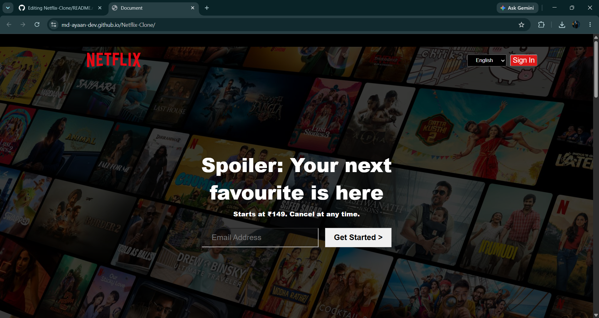
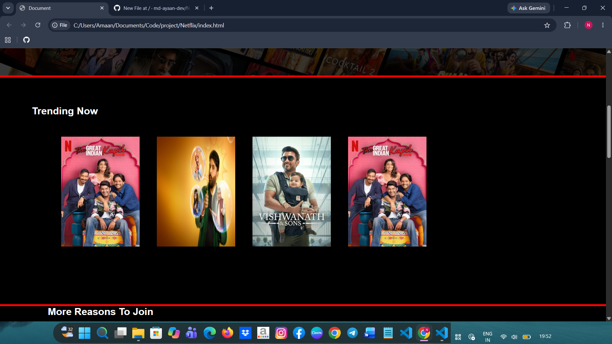
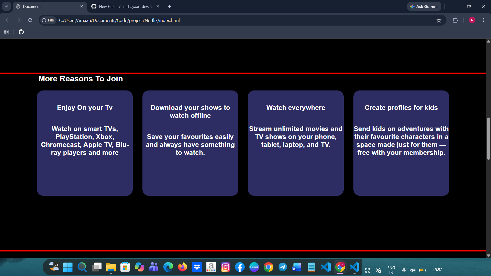
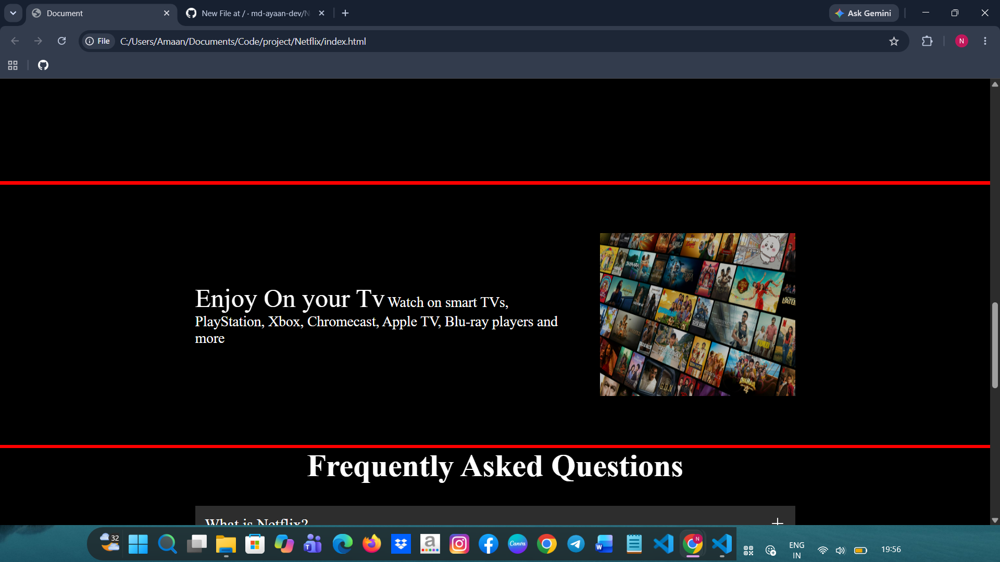
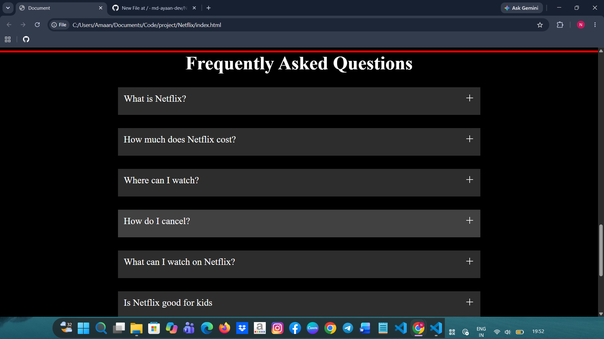

# 🎬 Netflix Clone – Responsive Website

https://md-ayaan-dev.github.io/Netflix-Clone/

A modern, responsive **Netflix-inspired landing page** built using HTML5 and CSS3. This project recreates the look and feel of Netflix's homepage, featuring a dark theme, trending movies, subscription section, FAQ section, and responsive layouts.

The project focuses on improving front-end development skills and creating a user-friendly experience across different screen sizes.

---

## 🌟 Features

- 🎨 Netflix-inspired modern UI design.
- 📱 Responsive layout for desktop, tablet, and mobile devices.
- 🌐 Navigation bar with language selection and Sign In button.
- 🎥 Hero section with email input and Get Started button.
- 🔥 Trending Now movie section.
- ⭐ Reasons to Join section with attractive cards.
- ❓ Frequently Asked Questions section.
- 📞 Footer with useful links and contact information.
- 📐 CSS Flexbox, Grid, and Media Queries for responsive layouts.

---

## 🛠️ Technologies Used

| Technology | Purpose |
|---|---|
| HTML5 | Website structure |
| CSS3 | Styling and design |
| Flexbox | Flexible layouts |
| CSS Grid | Grid-based layouts |
| Media Queries | Responsive design |

---

## 📸 Project Preview

### Homepage
The homepage features a Netflix-inspired hero section with a background image, navigation bar, subscription message, and email input.

### Trending Now
A section showcasing trending movie and entertainment thumbnails.

### More Reasons to Join
Attractive cards highlighting the benefits of joining Netflix.

### Frequently Asked Questions
An FAQ section displaying common questions in a clean layout.

### Footer
A structured footer containing useful links and language selection.

---

## 📂 Project Structure

## 📸 Project Screenshots

### 🏠 1. Homepage

### 🔥 2. Trending Now

### ⭐ 3. More Reasons to Join

### 📺 4. Enjoy on Your TV

### ❓ 5. Frequently Asked Questions & Footer

